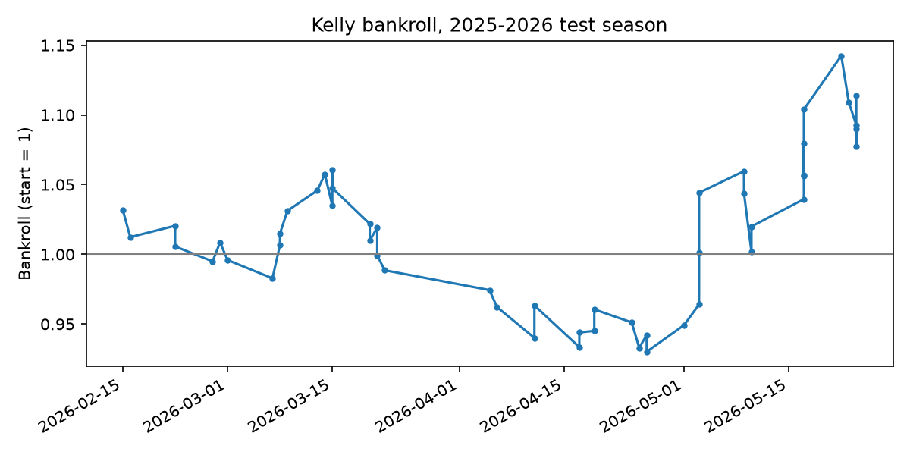
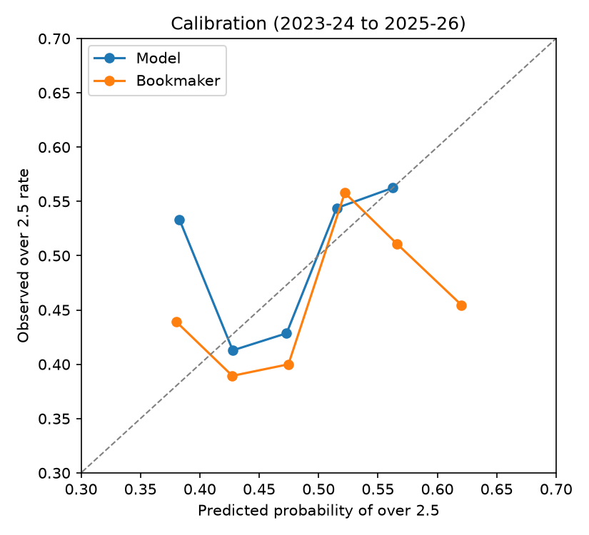

# Serie A Over/Under 2.5 prediction

Personal project: predicting whether a Serie A match ends with 3 or more goals,
and testing a betting strategy against the bookmakers' odds.

I collected six seasons of data (2020-21 to 2025-26, 2,280 matches), built
pre-match features (xG, shots, form, league table, Elo, rest days), selected the
most useful ones, tuned an XGBoost model and simulated a betting strategy with
the Kelly criterion.

**Result on the 2025-26 test season: 52 bets, +10.4% ROI, bankroll ×1.11.**

## Data

| Folder | Content | Source |
|---|---|---|
| `data/raw/football_data/` | results, shots, corners, over/under odds | [football-data.co.uk](https://www.football-data.co.uk/italym.php) |
| `data/raw/xg/` | expected goals per match | [Understat](https://understat.com/league/Serie_A) |
| `data/raw/fixtures/` | Champions League, Europa League, Conference League, Coppa Italia fixtures (for rest days) | [fixturedownload.com](https://fixturedownload.com), Coppa Italia by hand |

To avoid look-ahead, the features of a match only use matches played on earlier days.

## Method

### 1. Feature engineering
For each match I compute about 70 pre-match features:
- **Form:** averages over the last 3 and 5 games of goals, xG, shots, shots on
  target and corners, both scored and conceded
- **League table:** points, position, distance from the top 4 and from relegation
- **Elo rating:** every team starts the season at 1500 and is updated after every match
- **Fatigue:** rest days and number of games in the last 12 days, including cups
- **Over 2.5 rate:** each team's over 2.5 rate in its last 5 and 10 games

### 2. Feature selection (`src/feature_analysis.py`)
- **Redundant features:** I checked the correlations between features and their VIF.
- **Predictive power:** how strongly each feature is related to the number of
  goals, and whether this holds in every season.
- **Drop-one-feature test:** removing one feature at a time to see if the model
  gets better or worse.

The main finding is that over 2.5 depends on how many goals the two teams
produce together, not on which team is stronger. I kept 8 features:

| Feature | Meaning |
|---|---|
| `combined_xg_last5` | xG of both teams, last 5 games |
| `combined_goals_last5` | goals scored by both teams, last 5 games |
| `shots_on_target_total_last5` | shots on target of both teams |
| `xg_conceded_total_last5` | xG conceded by both teams |
| `shots_on_target_conceded_total_last5` | shots on target conceded by both teams |
| `home_over25_rate_last10`, `away_over25_rate_last10` | over 2.5 rate of each team, last 10 games |
| `home_goals_conceded_last5` | goals conceded by the home team |

### 3. Model and tuning (`src/tuning.py`)
To choose the hyperparameters, I trained the model on past seasons and tested it
on the next one, for every season from 2021-22 to 2024-25. As the metric I used
log-loss, which checks that the probabilities are realistic.

- **Grid search:** I tried 324 combinations of hyperparameters. The best model is
  very small, with 50 trees of depth 1. The signal in the data is weak, so a
  simple model works better.
- **Weighting the current season:** I tried three ways of giving more importance
  to the current season:
  1. adding extra trees trained on the most recent matches;
  2. retraining before every match day, with current-season matches weighted ×2 to ×5;
  3. adjusting the probabilities with the current season's over 2.5 rate.

  Option 3 gave the best average log-loss. The other two made the model follow
  the noise of the last few games.

**Final model:** XGBoost on the 8 features, trained before the start of the
season (older matches count less), with probabilities adjusted using the
current season's over 2.5 rate.

### 4. Betting strategy (`src/betting.py`)
- **When to bet:** only when my probability is at least 4 points higher than
  the probability implied by the odds.
- **How much:** a fraction of the Kelly stake, never more than 5% of the bankroll.
- **When:** from 10 February. By then the model has seen half of the current
  season, which the season adjustment needs.

### 5. Validation scheme

| Seasons | Role |
|---|---|
| 2020-21 to 2022-23 | training |
| 2023-24, 2024-25 | validation, used to choose the betting margin |
| 2025-26 | test |

## Results

**Betting (10 February to end of season)**

| Season | Role | Bets | Win rate | ROI | Kelly bankroll |
|---|---|---:|---:|---:|---:|
| 2023-24 | validation | 60 | 43.3% | −2.5% | 0.91x |
| 2024-25 | validation | 52 | 44.2% | −2.5% | 1.05x |
| **2025-26** | **test** | **52** | **50.0%** | **+10.4%** | **1.11x** |

In 2025-26 both sides made a profit: over bets 17 (+11.4%), under bets 35 (+9.9%).



**Probability quality (average of 2023-24 to 2025-26, lower Brier = better)**

| Forecast | Brier |
|---|---:|
| Model | 0.249 |
| Current season over 2.5 rate | 0.250 |
| Bookmaker odds | 0.246 |

The probabilities are well calibrated: when the model predicts about 43% the
observed rate is 41%, and when it predicts 52% it is 54%.



## Limitations and next steps

- **Sample size:** 52 bets in the test season are not enough for statistical
  significance (±31% at 2 standard errors). More seasons are needed to confirm the result.
- **Betting rule:** the margin rule replaced an earlier rule based on fixed
  probability thresholds. Once the probabilities were calibrated, that rule
  placed very few bets. The margin was chosen on the validation seasons only.
- **Odds:** I use the average market odds. The odds available when placing a bet can be different.
- **Next steps:**
  - Freeze the model and log predictions before each match day of 2026-27, as a true out-of-sample test.
  - Add player-level data (injuries, line-ups).
  - Use closing odds as a feature.
  - Add other leagues to get a larger sample.

## How to run

```bash
pip install -r requirements.txt
python src/build_dataset.py   # build the dataset
python src/backtest.py        # results and figures
```
